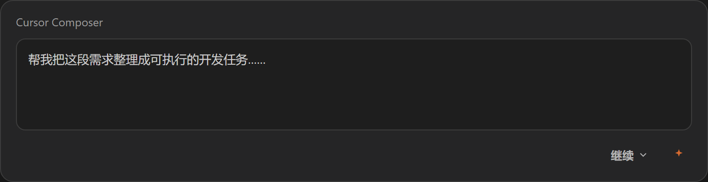
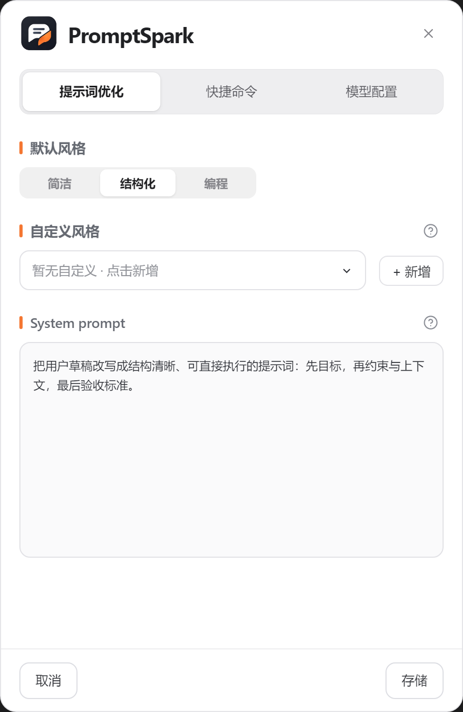
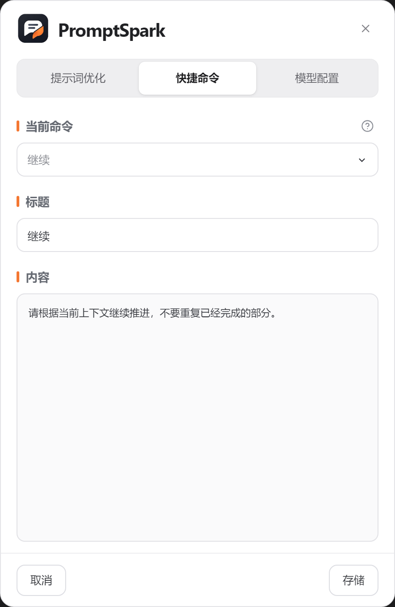
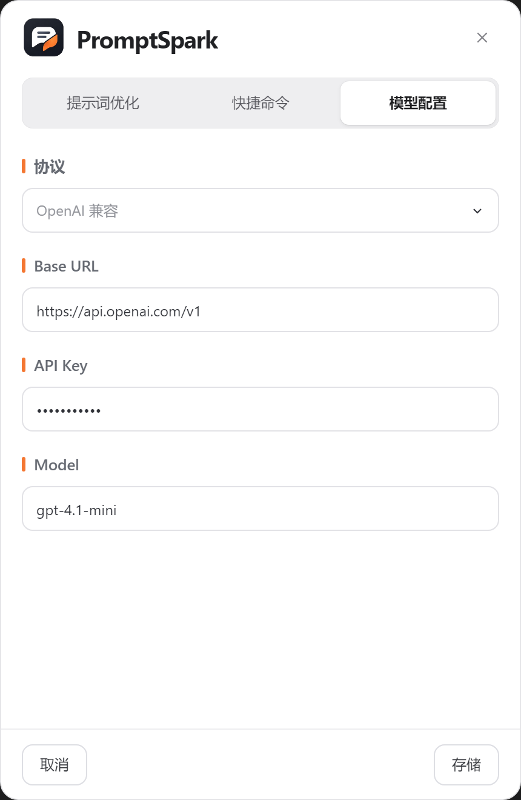
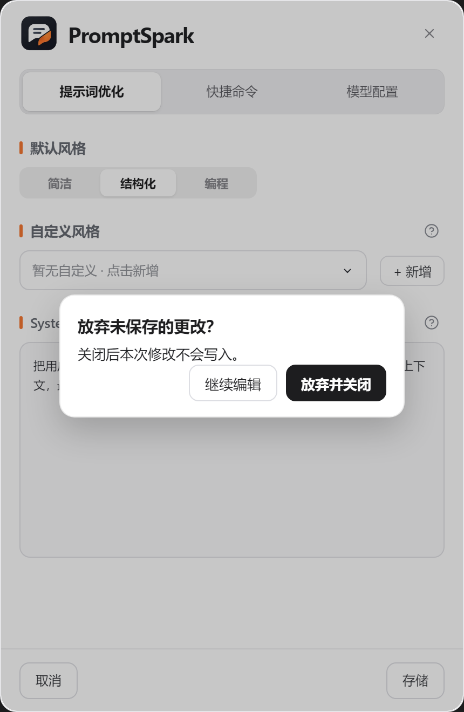

# PromptSpark

面向 **Cursor（Windows）**：在 Composer 旁加入提示词优化 / 还原，以及可切换的快捷命令。

> 仅支持 Cursor · Windows。Codex 桌面请用 [Codex++](https://github.com/xiaoyangtx996/CodexPlusPlus)。

## Screenshots

**Composer 控件**（继续 + 闪光）：

**提示词优化**

**快捷命令**

**模型配置**

**未保存确认**

## Features

| 能力 | 说明 |
|:---|:---|
| **优化 / 还原** | 点闪光 → 用你配置的模型改写提示词；再点还原；进行中再点可取消 |
| **快捷命令** | 左键填入并自动发送；右键切换命令 |
| **风格** | 默认「简洁 / 结构化 / 编程」锁定；可新增自定义风格 |
| **模型** | OpenAI 兼容或 Anthropic；扩展内嵌本机代理 `127.0.0.1:37841` |
| **设置** | 右键或 `Alt+点击` 闪光打开；底部「取消 / 存储」；Esc 同取消 |

快捷命令不需要 API Key；只有「优化」需要。配置经本机代理落盘，更新插件不丢。

## Install

1. 在 Cursor 扩展市场搜索 **PromptSpark** 安装，或从 [GitHub Releases](https://github.com/xiaoyangtx996/PromptSpark/releases) 下载 `.vsix` 拖入安装。
2. 若提示已写入 Composer 控件 → **完全退出并重新打开 Cursor**（托盘里的 Cursor 也要退；不要只 Reload Window）。
3. 写入失败时：以管理员运行 Cursor，命令面板执行 `PromptSpark: 注入 Composer 控件`。

## First use

1. Composer 写草稿 → 点闪光优化 / 再点还原  
2. 左侧「继续」→ **左键发送**，**右键切换命令**  
3. 右键闪光打开设置 → 填 API（优化用）与命令内容 → **存储**

## Commands

- `PromptSpark: 注入 Composer 控件`
- `PromptSpark: 移除 Composer 控件`

## Requirements

- Cursor on Windows
- 优化功能需要你自己的 LLM API Key（OpenAI 兼容或 Anthropic）
- 注入会写入 Cursor 安装目录下的 workbench 脚本；无写权限时需管理员运行

## Privacy

- API Key 与设置保存在本机（经内嵌代理落盘），不会上传到 PromptSpark 服务器。
- 优化请求发往你在设置里配置的模型 Base URL。

## Links

- 仓库：https://github.com/xiaoyangtx996/PromptSpark  
- Issues：https://github.com/xiaoyangtx996/PromptSpark/issues  
- Open VSX：https://open-vsx.org/extension/xiaoyangtx996/promptspark  
- License：MIT
